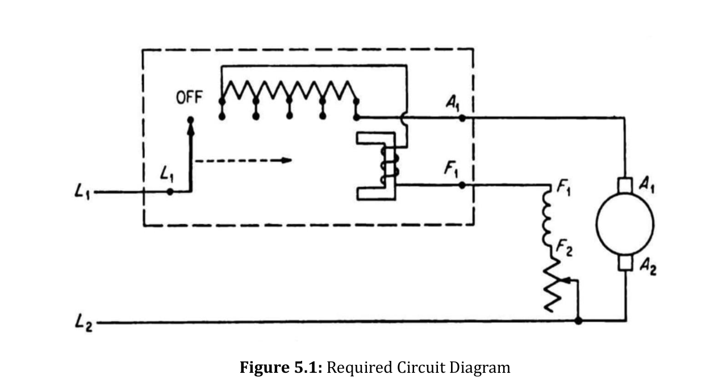

![[Pasted image 20261026110057.png]]

![[Pasted image 20261026121217.png]]

![[Working_Principles_of_a_DC_Motor.webp]]

![[Pasted image 20260729015156.png]]![[compound_iqim6l.webp|700]]
![[Pasted image 20261026134333.png|700]]
![[Pasted image 20260729030609.png]]
![[Pasted image 20260729013256.png]]
![[Pasted image 20261026154346.png]]
![[Pasted image 20261026183323.png]]![[Pasted image 20260729083801.jpg]]![[Pasted image 20261026195752.png]]![[Three-Point-Starter.-3-Point-Starter.webp]]![[Pasted image 20260729083801.jpg]]
![[Pasted image 20261026193118.png]]![[Pasted image 20260921081553.jpg]]
![[Pasted image 20260729092319.png]]
![[Pasted image 20260729092231.png|480]]
![[Copied_Item_1793051120342.png]]

![[Introductions-to-DC-Machines20.jpg]]
![[Pasted image 20261027123925.png]]![[simplex-duplex.webp]]
![[Copied_Item_1793051782353.png|607]]
![[Pasted image 20261027122917.jpg|314]]![[Pasted image 20261027124147.png|611]]![[Pasted image 20261027130713.png|622]]![[Armature-Windings-of-DC-Generator-Lap-Wave-pptx-5-2048.webp]]![[Pasted image 20261027124521.png]]
![[Pasted image 20261027134722.jpg|540]]![[Pasted image 20261027135344.png]]
![[Pasted image 20261027134931.jpg]]![[Pasted image 20261027141908.jpg|679]]![[Pasted image 20261027141328.png]]
![[Pasted image 20261027140456.png]]
![[Pasted image 20261027141022.png]]
#### Core Conceptual Differences

|**Parameter**|**Electric Motor**|**Electric Generator**|
|---|---|---|
|**Energy Conversion**|Electrical $\to$ Mechanical|Mechanical $\to$ Electrical|
|**Operating Principle**|Biot-Savart / Lorentz force on current-carrying conductor in a $\vec{B}$-field|Faraday’s Law of Induction & Lenz’s Law|
|**Direction Rule**|**Fleming's Left-Hand Rule**|**Fleming's Right-Hand Rule** (_Generato**R** = **R**ight_)|
|**Drive Source**|Connected power supply / voltage source|External prime mover (turbine, engine, crank)|
|**EMF Type**|**Back-EMF ($E_b$)** (opposes supply voltage $V$)|**Generated EMF ($E_g$)** (drives load current)|
|**Voltage Relation**|**$V > E_b$**|**$E_g > V$**|
|**Torque Role**|**Driving Torque** (rotates the rotor against load)|**Opposing/Counter Torque** (resists the prime mover)|

#### Voltage & Current Equations (DC Machine)

#### Motor

- **Voltage Balance:**
    
      
    
    $$V = E_b + I_a R_a$$
    
- **Armature Current:**
    
      
    
    $$I_a = \frac{V - E_b}{R_a}$$
    
- _At start ($N = 0 \implies E_b = 0$):_ $I_{\text{start}} = \frac{V}{R_a}$ _(very high; requires starter)_
* shunt Armature current: $I_a = I_L - I_f$.
      
    

#### Generator

- **Voltage Balance:**
    
      
    
    $$E_g = V + I_a R_a$$
    
- **Armature Current:**
    
      
    
    $$I_a = \frac{E_g - V}{R_a}$$
    
- _Terminal Voltage under load:_ $V = E_g - I_a R_a$
* shunt Armature current: $I_a = I_L + I_f$.
      
    

#### Governing Machine Equations (Identical Form, Opposite Roles)

#### Induced EMF Equation (Both)

$$E = \frac{P \Phi Z N}{60 A}$$

- $P$ = number of poles
    
      
    
- $\Phi$ = flux per pole ($\text{Wb}$)
    
      
    
- $Z$ = total armature conductors
    
      
    
- $N$ = rotational speed ($\text{rpm}$)
    
      
    
- $A$ = parallel paths ($A = 2$ for wave, $A = P$ for lap)
    
      
    
- **Motor ($E_b$):** Governs speed $\to N \propto \frac{E_b}{\Phi}$
    
      
    
- **Generator ($E_g$):** Governs open-circuit voltage $\to E_g \propto \Phi N$
    
      
    

#### Electromagnetic Torque Equation (Both)

$$T_e = \frac{P Z \Phi I_a}{2 \pi A} \propto \Phi I_a$$

- **Motor:** $T_e$ drives rotation in the direction of motion.
    
      
    
- **Generator:** $T_e$ is counter-torque (electromagnetic drag) opposing the prime mover.
    
      
    

#### Power Flow & Efficiency

#### Motor Power Flow

$$\text{Electrical Input } (V I_a) = \text{Mechanical Developed } (E_b I_a) + \text{Copper Loss } (I_a^2 R_a)$$

- **Efficiency:**
    
      
    
    $$\eta_m = \frac{P_{\text{mech, out}}}{P_{\text{elec, in}}} = \frac{T_{\text{shaft}} \cdot \omega}{V I_L}$$
    

#### Generator Power Flow

$$\text{Mechanical Input } (T_{\text{shaft}} \cdot \omega) \to \text{Electrical Developed } (E_g I_a) = \text{Electrical Output } (V I_a) + \text{Copper Loss } (I_a^2 R_a)$$

- **Efficiency:**
    
      
    
    $$\eta_g = \frac{P_{\text{elec, out}}}{P_{\text{mech, in}}} = \frac{V I_L}{T_{\text{shaft}} \cdot \omega}$$
    

#### Quick Hand-Rule Memory Aid

#### Fleming's Left-Hand Rule (Motor)

- **Thumb:** **T**hrust / Force / Motion
    
      
    
- **First Finger:** **F**ield ($\vec{B}$)
    
      
    
- **Second Finger:** **C**urrent ($\vec{I}$)
    
      
    

#### Fleming's Right-Hand Rule (Generator)

- **Thumb:** Motion of conductor (from prime mover)
    
      
    
- **First Finger:** **F**ield ($\vec{B}$)
    
      
    
- **Second Finger:** Induced **C**urrent ($\vec{I}$)

#### 5. Total Resultant Back-EMF ($E_b$)
    $$E_b = (\text{Conductors in series per path}) \times (\text{Average EMF per conductor})$$
    
    $$E_b = \left(\frac{Z}{A}\right) \times \left(\frac{P \Phi N}{60}\right)$$
    
    $$E_b = \frac{P \Phi Z N}{60 A}$$
    

#### Formulation in Terms of Angular Velocity ($\omega_m$)

- In dynamic drive control and electromechanical analysis, speed is expressed in mechanical radians per second ($\omega_m$):
    
    $$\omega_m = \frac{2 \pi N}{60} \implies N = \frac{60 \, \omega_m}{2 \pi}$$
    
- Substituting this relationship into the Back-EMF expression:
    
    $$E_b = \frac{P \Phi Z}{60 A} \left(\frac{60 \, \omega_m}{2 \pi}\right) = \left(\frac{P Z}{2 \pi A}\right) \Phi \, \omega_m$$
    
- Defining the constant machine design parameter $K_a$:
    
    $$K_a = \frac{P Z}{2 \pi A}$$
    
- The compact electromechanical Back-EMF relation becomes:
    
    $$E_b = K_a \Phi \, \omega_m$$
#### Factors Controlling Motor Speed

- **Governing Formula:**
    
    $$N = \frac{V - I_a R_a}{Z\Phi}\left(\frac{A}{P}\right) = K \frac{V - I_a R_a}{\Phi} \propto \frac{E_b}{\Phi} \quad (\text{r.p.s.})$$
    
    _(where constant $K = \frac{A}{ZP}$ and back-EMF $E_b = V - I_a R_a$)_
    

#### 3 Ways to Control Speed

1. **Flux ($\Phi$) Control:**
    
    - $N \propto \frac{1}{\Phi}$
        
    - Vary field current via field rheostat (controls speed above rated speed).
        
2. **Armature Resistance ($R_a$) Control:**
    
    - $N \propto (V - I_a R_a)$
        
    - Add external resistance in series with armature (controls speed below rated speed).
        
3. **Terminal Voltage ($V$) Control:**
    
    - $N \propto V$
        
    - Vary input supply voltage (e.g., Ward-Leonard system).

#### E and Torque

 $E_b = K\Phi\omega$    
$T_a = K\Phi I_a$
$$K = \frac{P \cdot Z}{2\pi \cdot A}$$

#### Terminal Characteristic of a Shunt DC Motor

1. **Armature loop equation:**
    
    $$V_T = E_A + I_A R_A$$
    
2. **Substitute induced voltage ($E_A = K\phi\omega$):**
    
    $$V_T = K\phi\omega + I_A R_A$$
    
3. **Substitute armature current ($I_A = \frac{\tau_{\text{ind}}}{K\phi}$):**
    
    $$V_T = K\phi\omega + \frac{\tau_{\text{ind}}}{K\phi} R_A$$
    
4. **Solve for motor speed ($\omega$):**
    
    $$\omega = \frac{V_T}{K\phi} - \frac{R_A}{(K\phi)^2} \tau_{\text{ind}}$$

#### Terminal Characteristic of a Series DC Motor

1. **Kirchhoff's voltage law (KVL):**
    
    $$V_T = E_A + I_A (R_A + R_S)$$
    
2. **Flux & torque relation (assuming linear core, $\phi = c I_A$):**
    
    $$\tau_{\text{ind}} = K\phi I_A = Kc I_A^2 \implies I_A = \sqrt{\frac{\tau_{\text{ind}}}{Kc}}$$
    
3. **Substitute induced voltage ($E_A = K\phi\omega = Kc I_A \omega$):**
    
    $$V_T = Kc I_A \omega + I_A (R_A + R_S)$$
    
4. **Substitute armature current ($I_A = \sqrt{\frac{\tau_{\text{ind}}}{Kc}}$):**
    
    $$V_T = \sqrt{Kc\,\tau_{\text{ind}}}\,\omega + \frac{R_A + R_S}{\sqrt{Kc}}\sqrt{\tau_{\text{ind}}}$$
    
5. **Solve for motor speed ($\omega$):**
    
    $$\omega = \frac{V_T}{\sqrt{Kc}} \frac{1}{\sqrt{\tau_{\text{ind}}}} - \frac{R_A + R_S}{Kc}$$

#### Current Paths in Frog-Leg Winding

- **Formula:**
    

$$a = 2 P m_{\text{lap}}$$

- **Parameters:**
    
    - $a$ = number of parallel current paths
        
    - $P$ = number of poles
        
    - $m_{\text{lap}}$ = plex of the lap winding

#### Wave Winding Prerequisite Concepts & Formulas

- **Core Variables:**
    
      
    - $S$ = Number of slots
        
          
        
    - $P$ = Number of poles
        
          
        
    - $C$ = Number of coils / commutator segments ($C = S$ for 2 coil sides per slot)
        
          
        
    - $Z$ = Total number of coil sides / elements ($Z = 2C$)
        
          
        
    - $m$ = Plex of winding (Simplex = $1$, Duplex = $2$, Triplex = $3$)
        
          
        

#### 1. Slot & Commutator Pitches (Chapman / Kosow Notation)

- **Pole Pitch ($Y_P$):** Distance between adjacent poles in slots.
    
      
    

$$Y_P = \frac{S}{P}$$

- **Coil Span / Back Pitch in Slots ($Y_S$):** Number of slots spanned by one coil (rounded down to an integer for fractional-pitch to save copper and improve commutation).
    
      
    

$$Y_S = \lfloor Y_P \rfloor \quad (\text{nearest integer } \le Y_P)$$

- **Commutator Pitch ($Y_C$):** Distance (in commutator segments) between the two ends of a coil connected to the commutator. **Must be an integer.**
    
      
    

$$Y_C = \frac{2(C \pm m)}{P}$$

$+m$: Progressive winding (moves forward after 1 loop around the armature).

  

$-m$: Retrogressive winding (moves backward after 1 loop).

  

#### 2. Element / Coil-Side Pitches (Standard Winding Rules)

- **Back Pitch ($Y_b$):** Distance (in coil sides) spanned at the back of the armature. **Must be an odd integer** (connects a top odd-numbered side to a bottom even-numbered side).
    
      
    

$$Y_b = 2Y_S + 1 \approx \frac{Z}{P}$$

- **Front Pitch ($Y_f$):** Distance (in coil sides) spanned at the commutator end from the end of one coil to the start of the next. **Must be an odd integer.**
    
      
    
- **Resultant Pitch ($Y_R$):** Distance (in coil sides) between the beginnings of two consecutive coils in the winding sequence.
    
      
    

$$Y_R = Y_b + Y_f = 2Y_C \quad \text{(for Wave Winding)}$$

_(Note: For Lap Winding, $Y_R = Y_b - Y_f = \pm 2m$)_

  

- **Average Pitch ($Y_{\text{av}}$):** Must equal the commutator pitch ($Y_C$).
    
      
    

$$Y_{\text{av}} = \frac{Y_b + Y_f}{2} = \frac{C \pm m}{P/2} = Y_C$$

#### 3. Parallel Current Paths ($a$)

- **Wave Winding:** $a = 2m$
    
      
    
- **Lap Winding:** $a = mP$
    
      
    
- **Frog-Leg Winding:** $a = 2 P m_{\text{lap}}$

*  Flux ($\Phi$) = $600\text{ kilolines} = 600 \times 10^3 \times 10^{-8}\text{ Wb} = 0.006\text{ Wb}$
* **Basic relation:**
    

$$1\text{ line (Maxwell)} = 10^{-8}\text{ Wb}$$